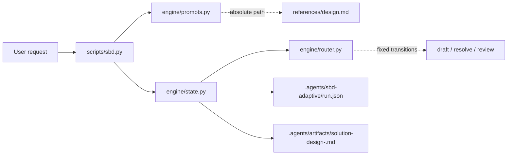

# Architecture

Status: draft, inferred

`simple-by-design-adaptive` is a local CLI that routes one agent through a fixed design sequence: draft → resolve one gap → review, then publish. It is design-only; there is no ledger, agent-selected workflow or implementation step.

## Components

- `scripts/sbd.py` is the CLI. It starts a run with `--request`, resumes with no arguments, and accepts one result with `done TICKET`. It prints the next prompt or resumption command; errors go to stderr with a resume hint.
- `scripts/engine/router.py` owns checkpoint schema 2, result shapes and transitions. `draft` accepts `candidate` or `need`; `resolve` accepts `resolved` or `blocked`; `review` accepts `pass`, `revise` or `need`. `advance` issues a fresh opaque ticket for every non-pass result and fixes the artifact path on pass.
- `scripts/engine/state.py` is the only writer. It resolves the task root, stores `.agents/sbd-adaptive/run.json`, serialises writers with `flock`, rejects symlinked ancestors and non-regular files, and publishes via temporary file, `fsync`, `os.replace` and directory `fsync`. Duplicate JSON keys are rejected. A durable passing review is replayed idempotently; conflicting artifacts are never overwritten.
- `scripts/engine/prompts.py` holds the static prompt text, the JSON contract and bounded context. Draft and review append an absolute path to `references/design.md`; resolve omits it. The printed return command uses absolute paths.
- `references/design.md` holds common design defaults, ten language profiles and the instruction-design rule. The agent reads it on demand; it is not embedded in every prompt.
- `tests/` holds the stdlib `unittest` suite covering routing, state, concurrency, publication recovery, prompt disclosure and instruction budgets.

## Invariants

- **Design only:** prompts and completion never authorise implementation or external effects.
- **One state owner:** the CLI owns transitions; the agent supplies only the requested result.
- **Opaque tickets:** a ticket is accepted once, only for the current prompt; stale or duplicate results do not advance.
- **Fail closed:** corrupt, legacy or symlinked state is refused rather than repaired.
- **Portable runtime:** Python 3.11+ on POSIX, standard library only.
- **Bounded instructions:** SKILL body ≤100 words; ordinary emitted static surface ≤400 words; guidance ≤350 words; combined ≤750 words.
- **No ledger:** no history, workflow selection or agent-authored next step.

## Data flow

A request enters `sbd.py` and becomes a checkpoint. The agent performs the printed prompt, submits JSON through the printed ticket, and receives the next prompt. A `need` result temporarily routes to `resolve`; `revise` returns to `draft` with named gaps; `blocked` pauses until resumed. A passing review writes the Markdown artifact and prints `DONE`.
